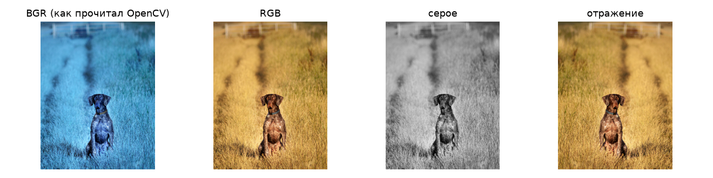
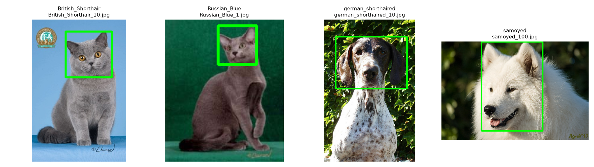

# Лабораторная 1: среда, репозиторий и первый взгляд на данные

**Вариант:** 06

## 1. Задача

Скачать данные своего варианта, разобраться, как OpenCV представляет изображение (shape, dtype, порядок BGR), и собрать сводку по датасету: размеры, форматы, режимы, наличие бокса головы.

## 2. Как запустить

Запускал локально (Python 3.11, OpenCV 4.14). Ноутбук без правок работает в Colab и Kaggle; в Kaggle нужно включить Internet в Settings. Номер варианта уже вписан в первой ячейке (`VARIANT = 6`), данные скачивает она же.

```bash
pip install -r requirements.txt
# откройте lab01/solution.ipynb и выполните Run All
```

## 3. Данные

Вариант 06, 800 изображений, 4 породы по 200 фото:

| class_id | Порода | Вид |
| --: | --- | --- |
| 0 | British_Shorthair (британская короткошёрстная) | cat |
| 1 | Russian_Blue (русская голубая) | cat |
| 2 | german_shorthaired (курцхаар) | dog |
| 3 | samoyed (самоедская собака) | dog |

Ничего не выкидывал.

## 4. Результаты

Полная таблица лежит в [`results/summary.csv`](results/summary.csv).

| Что | Значение |
| --- | --: |
| Файлов / пород | 800 / 4 |
| Кошек / собак | 400 / 400 |
| Самая крупная порода к самой малочисленной | 1,0 (по 200) |
| Ширина min / медиана / max, px | 194 / 500 / 1200 |
| Высота min / медиана / max, px | 196 / 375 / 900 |
| Наибольшее соотношение сторон | 2,38 (`german_shorthaired_82.jpg`, 210×500) |
| Не в режиме RGB | 0 |
| `.jpg`, который на деле не JPEG | 0 |
| С XML-боксом головы | 399 (49,9 %) |





## 5. Выводы

- Мой вариант чистый: 0 файлов не в режиме RGB и 0 `.jpg`, которые на деле не JPEG. Для trimap `cv2.imread` по умолчанию возвращает `(500, 386, 3)`, а с `IMREAD_UNCHANGED` `(500, 386)`, то есть без флага OpenCV молча раздувает один канал до трёх.
- Классы поделены идеально ровно: по 200 фото на породу, соотношение крупной породы к малочисленной 1,0. Перевзвешивать классы в лабе 4 не придётся.
- Размеры сильно разбросаны: от 194 до 1200 px по ширине. Самое вытянутое фото `german_shorthaired_82.jpg` (210×500, соотношение 2,38) после `cv2.resize(img, (224, 224))` сожмётся по высоте в 2,2 раза, а по ширине почти не изменится, и собака станет заметно шире, чем на самом деле.
- Бокс головы есть только у 399 из 800 изображений (49,9 %): по 100 у каждой породы и 99 у самоеда. Для детекции в лабе 5 останется вдвое меньше данных.
- Пиксель в центре `german_shorthaired_48.jpg` в BGR равен `[19 25 54]`, после `cvtColor` `[54 25 19]`. matplotlib читает первый канал как красный, поэтому без конвертации рыжая трава и собака становятся синими.
