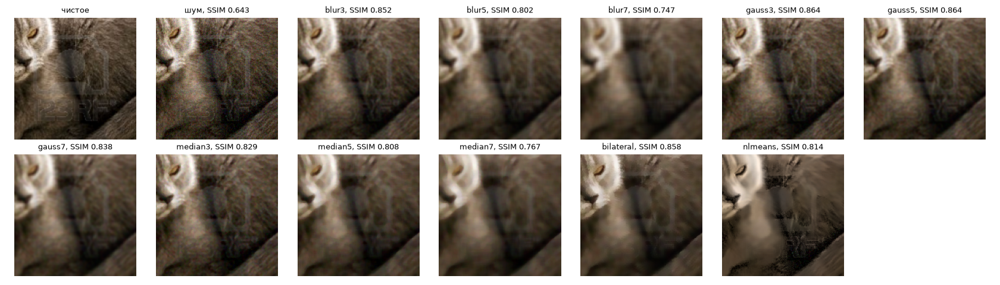
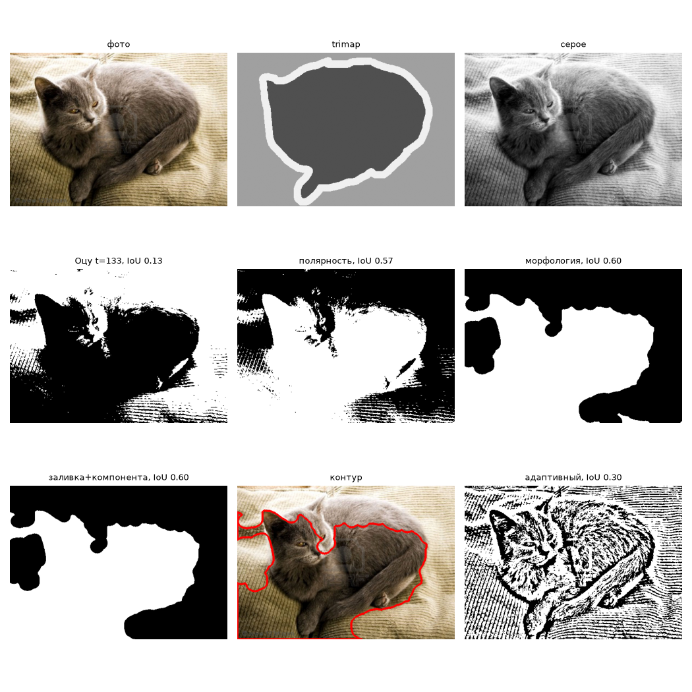
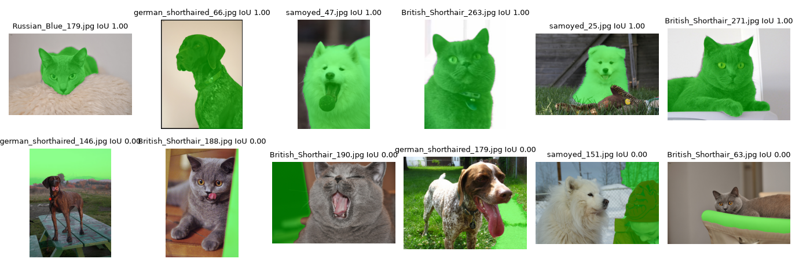

# Лабораторная 2: классическая обработка — цвет, фильтры, пороги, морфология, контуры

**Вариант:** 06

## 1. Задача

Оценить яркость, контраст, шум и резкость фото варианта, сравнить способы коррекции яркости и фильтры против шума своего варианта. Затем без нейросети получить маску животного (Оцу → полярность → морфология → заливка → самая большая компонента) и проверить её по trimap через IoU.

## 2. Как запустить

Запускал локально (Python 3.11, OpenCV 4.14, scikit-image 0.26). Ноутбук без правок работает в Colab и Kaggle; в Kaggle нужно включить Internet в Settings. Номер варианта уже вписан в первую ячейку (`VARIANT = 6`), данные скачивает она же. Run All занимает около 3 минут на CPU.

```bash
pip install -r requirements.txt   # для estimate_sigma нужен ещё PyWavelets: pip install PyWavelets
# откройте lab02/solution.ipynb и выполните Run All
```

## 3. Данные

Вариант 06: 800 фото, 4 породы по 200 (British_Shorthair, Russian_Blue — кошки; german_shorthaired, samoyed — собаки). Шум из `NOISE_PLAN`: `gauss`, σ = 10. Ничего не выкидывал.

## 4. Результаты

| Что | Значение |
| --- | --: |
| Лучший фильтр (`BEST_FILTER`) | `gauss3` |
| PSNR / SSIM без фильтра | 28,34 дБ / 0,643 |
| PSNR / SSIM `gauss3` | 33,00 дБ / 0,864 |
| PSNR / SSIM `bilateral` (лучший по PSNR) | 33,05 дБ / 0,858 |
| Время `gauss3` / `bilateral` / `nlmeans` | 0,12 / 13,0 / 185 мс на кадр |
| Выбранный канал (`CHANNEL`) | `gray` (IoU 0,492; `b` 0,341; `S` 0,338; `a` 0,245) |
| IoU «только Оцу» (средняя / медиана) | 0,253 / 0,147 |
| IoU итоговая (средняя / медиана) | 0,492 / 0,489 |







## 5. Выводы

- **Фильтр.** На гауссовом шуме σ = 10 победители по двум метрикам разошлись: по SSIM лидирует `gauss3` (0,864), по PSNR — `bilateral` (33,05 дБ против 33,00). Медиана 3×3 дала только 0,829 SSIM: она хорошо убирает одиночные выбросы, а гауссов шум задевает каждый пиксель. Выбрал `gauss3`: он в ~100 раз быстрее билатерального (0,12 мс против 13 мс), а `nlmeans` с 185 мс на кадр оказался даже хуже по качеству (SSIM 0,814).
- **Яркость.** `equalizeHist` по каналам RGB сдвинул цвет на 16,9 (|Δa| + |Δb|), а `equalizeHist` по L только на 0,69. Каналы R, G и B выравниваются независимо, поэтому меняется их соотношение, то есть оттенок. При коррекции по L каналы a и b не трогаются. Гамма 0,5 тоже даёт заметный сдвиг (6,55): она меняет RGB нелинейно.
- **Фото варианта.** Средние яркости пород близки: от 122,6 у самоедов (светлая шерсть, но часто снег и пересвеченный фон) до 128,4 у русских голубых. Резкость различается сильнее всего: у курцхааров 1262, у британцев 460. Пятнистая короткая шерсть и уличный фон дают много перепадов.
- **Шаги пайплайна.** Больше всего дала исправленная полярность: средняя IoU выросла с 0,255 до 0,443. Примерно на половине фото Оцу делает белым фон, а не животное. Фильтр перед порогом почти ничего не дал (0,253 → 0,255). Морфология и заливка с выбором компоненты добавили ещё 0,03 и 0,02.
- **Каналы и худшие маски.** Серый канал выиграл у `b` на 0,15 IoU (0,492 против 0,341): у кошек и собак варианта шерсть серая, белая или коричневая, и по цвету они отличаются от фона хуже, чем по яркости. У 195 из 800 фото IoU < 0,2. Среди 6 худших (IoU 0) маска во всех случаях ушла на фон похожей яркости: небо, стену, плед, траву. Часто животное к тому же касается края кадра, и проверка полярности по рамке ошибается.
- **Форма.** Маски собак чуть плотнее масок кошек (solidity 0,715 против 0,711) и вытянуты меньше (1,49 против 1,51), но разница мала: маска часто захватывает фон, и форма отражает его, а не животное. Лучше всего метод работает на самоедах (IoU 0,598): белая собака контрастна почти на любом фоне. Хуже всего — на курцхаарах (0,432): пятнистая шерсть распадается при пороге.
